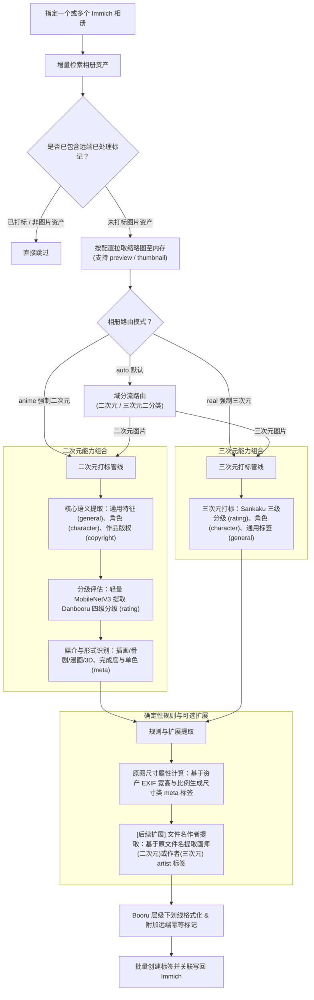

# Immich Booru Tagger 流程与功能设计文档

## 1. 项目定位与架构形态

本项目是一个面向 **Immich** 的本地自动化图片打标工具，采用**单机直连、主动拉取式的批处理架构**。

- **无中间服务**：不搭建独立的推理微服务，由运行在本地算力机器（CPU / GPU）上的同步批处理程序直接作为客户端调用 Immich 接口。
- **无本地状态**：不在本地维护数据库或状态文件，完全依托 Immich 远端标记标签实现增量检索与重复执行的幂等性。
- **单周期模型复用**：在单次批处理生命周期内完成视觉模型的加载与常驻复用，避免反复冷启动开销。
- **轻量内存流转**：逐张拉取图片的预览图/缩略图到内存中进行推理并即时释放，仅保留轻量标签文本用于微批次写回，避免原图传输、磁盘临时文件读写以及大量图片同时驻留内存的开销。

---

## 2. 核心业务流程

整体工作流由 **“拉取图片 → 域分流 → 本地推理与元数据提取 → 标签格式化与批量写回”** 四个阶段组成闭环：

---

## 3. 功能模块设计

### 3.1 资产增量拉取与无状态幂等

- **相册范围与路由模式指定**：支持指定一个或多个 Immich 相册作为批处理目标，并可为每个相册单独配置路由模式（`auto` 自动分流、`anime` 强制二次元、`real` 强制三次元，默认 `auto`）。
- **远端幂等过滤**：检索相册内的图片资产时，通过检查资产是否已携带约定的远端标记标签（如 `meta/booru_tagged`）来判断是否已处理。已携带标记的图片直接跳过，确保任务随时中断或重复执行均具备幂等性。
- **可配置缩略图拉取**：仅拉取图片的缩略图到内存中供模型推理，支持在配置中选择拉取高清预览图（`preview`）或小尺寸缩略图（`thumbnail`），在推理精度与网络传输开销之间按需权衡。

### 3.2 域分流路由

- **相册级路由覆盖**：若目标相册显式指定了 `anime` 或 `real` 模式，则跳过二分类直接进入对应管线，既消除边缘画风误判，也避免加载无关模型。
- **极轻量二分类（`auto` 模式）**：未锁定域的相册图片经过 `dghs-imgutils` 的 `anime_real` 轻量分类器（默认模型 `mobilenetv3_v1.2_dist`）进行域判别。
- **双管线分流**：根据分类结果将图片自动路由至“二次元打标管线”或“三次元打标管线”，使不同画风与领域的图片由最匹配的专用模型处理。

### 3.3 二次元打标管线（轻量精准组合）

二次元图片由 `dghs-imgutils` 驱动，采用“主力语义模型 + 轻量专用分类器”的串联组合，不通过视觉模型猜测画师（`artist`）：

1. **角色、作品版权与通用特征提取**：
   - 使用 `anime_pixai`（默认模型 `v0.9`）提取画面的通用特征标签（`general`）、角色标签（`character`），并基于角色关联关系自动推导作品版权标签（`copyright`）。
2. **Danbooru 四级分级提取**：
   - 采用极轻量的 `animetimm/mobilenetv3_large_150d.dbv4-full` 模型（基于 `dghs-imgutils` 多标签 TIMM 推理接口，关闭内置阈值截断并取最高置信度项），在极低内存与算力开销下提取原生兼容 Danbooru 标准的四级内容分级（`general`、`sensitive`、`questionable`、`explicit`）。
3. **画面媒介与形式识别**：
   - 使用 `anime_classify`（默认模型 `mobilenetv3_v1.3_dist`）与 `anime_completeness`（默认模型 `mobilenetv3_v2.2_dist`）两个极轻量分类模型，分别识别图片的载体形式（插画、漫画、番剧截图、3D 渲染；若判别为 `not_painting` 则忽略不写入）以及色彩与完成度状态（精修、草稿/线稿、单色/黑白），归入元数据标签（`meta`）。

### 3.4 三次元打标管线

三次元图片由 `dghs-realutils` 驱动：

- **三次元综合特征提取**：使用 `real_idolsankaku` 模型一次性提取人物角色（`character`）、通用特征标签（`general`）以及内容分级（`rating`）。
- **独立分级体系**：三次元分级保留模型原生的三级体系（`safe`、`questionable`、`explicit`），不强行与二次元的四级体系做对齐映射。

### 3.5 元数据规则计算与预留扩展

除视觉模型推理外，系统结合资产自身的客观元数据补充标签：

1. **原图尺寸与比例计算（`meta`）**：
   - 直接读取 Immich 资产 EXIF 中的原图真实宽高与像素数，计算并生成图像尺寸属性标签（如超高分辨率、高分辨率、低分辨率、长图、宽图等），避免因使用缩略图推理导致尺寸判断失真。
2. **文件名提取画师/作者（`artist`，当前暂不实现，后续可选功能）**：
   - 预留通过原图文件名规则提取画师（二次元）或作者（三次元）名称的扩展能力，作为可选附加功能在后续迭代中接入。

### 3.6 标签规范化与批量写回

1. **Booru 规范层级下划线标签**：
   - 所有产出的标签按照 Booru 标准分类体系组织为 Immich 层级标签，分类前缀与标签名之间以层级分隔，标签名称内部统一采用下划线格式。
   - 包含的标签分类层级：
     - `rating`：内容分级（二次元四级 / 三次元三级）
     - `copyright`：作品版权 / IP
     - `character`：角色名称
     - `general`：通用画面特征
     - `meta`：画面媒介形式、原图尺寸属性以及远端幂等标记（如 `meta/booru_tagged`）
     - `artist`：画师（二次元）或作者（三次元）名称（预留扩展）
2. **批量回写闭环**：
   - 仅在内存中按单次或微批次缓存各资产产出的轻量标签文本，结合远端已处理标记，通过 Immich 的标签管理接口批量完成标签创建与资产关联，确保业务标签与幂等标记同步落库。
